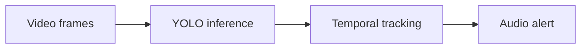

# Closed-Eye Monitor

A computer-vision experiment that tracks sustained closed-eye detections and plays an alert.

**Python, OpenCV, Ultralytics / YOLO, pygame**

## What it does

- Processes video frames with a YOLO model and class-based detections.
- Tracks elapsed closed-eye time rather than alerting from a single frame.
- Plays an audio alert after the configured interval.

## Workflow



## Local setup and use

```powershell
python -m venv .venv
.venv\Scripts\Activate.ps1
python -m pip install -r requirements.txt
python src/main.py
```
Python 3.11+ is recommended. Tkinter requires a desktop Python installation.
Supply an authorized model at `model/best.pt` and a sound at `assets/alarm.wav`; these are not distributed. Check `src/config.py` before running.

## Boundaries and limitations

No accuracy, crash-prevention or driver-safety claim is made. This is an experiment, not a safety device. Lighting, camera position, training data and hardware affect detections. Model weights and upstream libraries have independent licensing requirements.

This is a source snapshot, not a claim of production readiness. Business results, dates and unmeasured performance are intentionally not asserted. Application UI language is preserved.

## License

Original application code is available under the [MIT license](LICENSE). Third-party libraries, models, fonts and bundled assets retain their own licenses.

## Verification record

See [snapshot checks and remaining limitations](docs/VERIFICATION.md).
